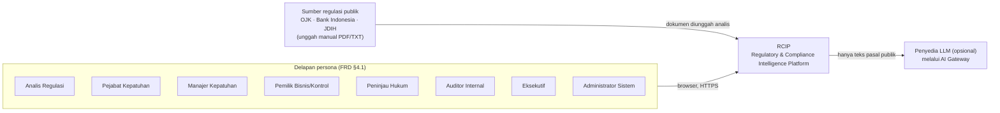
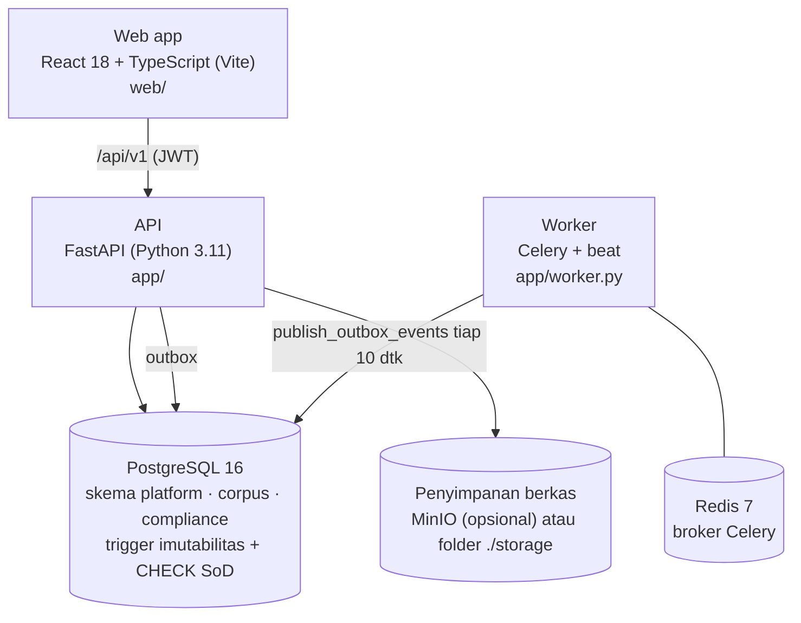
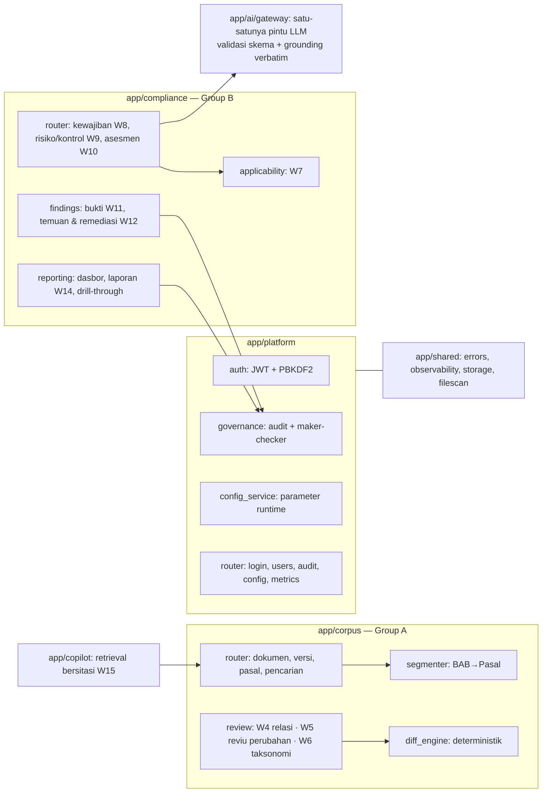
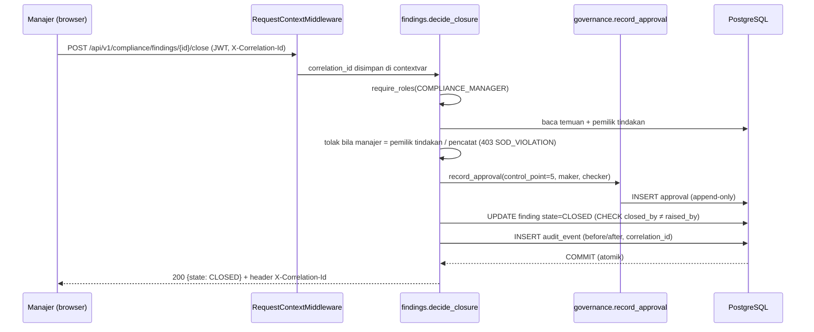

# Arsitektur RCIP

Dokumen ini menjelaskan arsitektur solusi sebagaimana diimplementasikan (bukan rencana). Acuan: TRD RCIP-TRD-001 §3–§5, ADR-01…ADR-04.

## 1. Konteks sistem (C4 level 1)

RCIP tidak mengirim apa pun ke regulator (A-09) dan tidak menerima data klien nyata (A-01, A-06). Tanpa `OPENAI_API_KEY`, ekstraksi memakai ekstraktor aturan `rule-based-v2` (moda terdokumentasi, NFR-13).

## 2. Container (C4 level 2)

| Container | Teknologi | Tanggung jawab |
|---|---|---|
| Web app | React 18, TypeScript, Vite | Antarmuka per peran; tidak menyimpan logika otorisasi (hanya cermin) |
| API | FastAPI, SQLAlchemy 2, Pydantic 2 | Semua aturan bisnis, state machine, RBAC, SoD, audit |
| Worker | Celery + beat | Pemrosesan outbox (event lama `DOCUMENT_CHANGE_MATERIAL`); siap untuk job terjadwal |
| Database | PostgreSQL 16 | Satu basis data, tiga skema (ADR-02); integritas dan imutabilitas ditegakkan di DB |
| Penyimpanan | MinIO / filesystem | Berkas bukti & dokumen; checksum SHA-256 dicatat di DB |

## 3. Komponen di dalam API (C4 level 3)

Batas kontrak antarkelompok (FRD §15): Group B membaca korpus hanya melalui sitasi `provision_version_id` dan `POST /citations/resolve`.

## 4. Satu permintaan ujung ke ujung — penutupan temuan (titik kendali #5)

## 5. Rantai kepatuhan sebagai foreign key

`regulatory_source → document → document_version → provision_version → (change) → applicability_decision → obligation → risk/control (obligation_control_map) → evidence → assessment → finding → remediation_action → approval → compliance_report → audit_event`

Semua FK `ON DELETE RESTRICT`; tidak ada penghapusan berantai. ERD lengkap: [erd.md](erd.md).

## 6. Pagar pengaman yang ditegakkan di database (bukan hanya UI)

| Aturan | Mekanisme |
|---|---|
| Versi terbit & teks pasalnya imutabel | trigger `trg_dv_frozen`, `trg_pv_frozen` |
| Audit & persetujuan append-only | trigger `trg_audit_append_only`, `trg_approval_append_only` |
| Draf AI tidak bisa dipetakan ke kontrol | trigger `trg_block_ai_draft` |
| Bukti ACCEPTED dan laporan ISSUED imutabel | trigger `trg_evidence_immutable`, `trg_report_immutable` |
| Pemisahan tugas | CHECK `ck_obligation_sod`, `ck_applicability_sod`, `ck_assessment_signoff_sod`, `ck_finding_closure_sod`, `ck_report_issue_sod`, `ck_change_confirm_sod` |
| Kewajiban aktif wajib bertuan | CHECK `ck_active_needs_owner` |
| Operasional EFFECTIVE dilarang bila desain INEFFECTIVE | CHECK `ck_assessment_design_operating` |
| Parameter runtime dalam batas | CHECK `ck_config_bounds` |

## 7. Keputusan arsitektur (ringkas)

| ADR | Keputusan | Alasan |
|---|---|---|
| ADR-01 | Monorepo FastAPI + React | Satu basis kode untuk dua kelompok (A-10) |
| ADR-02 | Satu PostgreSQL, tiga skema | FK lintas domain menjaga rantai; satu transaksi untuk keputusan + audit |
| ADR-03 | Transactional outbox | Event tidak hilang bila worker mati; propagasi materialitas juga dijalankan sinkron saat konfirmasi |
| ADR-04 | AI Gateway tunggal | Log prompt/model/versi, validasi skema, grounding verbatim, degradasi tanpa LLM |

## 8. Observabilitas

Setiap respons membawa `X-Correlation-Id` yang juga ditulis ke `audit_event.correlation_id`; log permintaan berbentuk JSON (metode, path, status, durasi). `GET /api/v1/metrics` (Admin/Auditor) memberi hitungan per endpoint, latensi rata-rata, error 5xx, login gagal, pembatasan laju, dan percobaan SoD yang diblokir.
