# ERD RCIP

_Dibangkitkan otomatis dari foreign key database (`python -m seed.data_dictionary`)._

Rantai inti: sumber → dokumen → versi → ketentuan → perubahan → keberlakuan → kewajiban → risiko/kontrol → asesmen → bukti → temuan → remediasi → persetujuan → laporan → audit.

```mermaid
erDiagram
    compliance__applicability_decision {
        uuid id PK
        uuid target_version_id FK
        uuid profile_id FK
        text decision_value
        text reason_text
        jsonb relied_upon_attributes
        uuid maker_id FK
        uuid approver_id FK
        timestamp_with_time_zone created_at
        text state
        jsonb cited_provision_version_ids
        jsonb scope_provision_version_ids
    }
    compliance__assessment {
        uuid id PK
        uuid control_id FK
        text result
        text notes
        uuid assessed_by FK
        timestamp_with_time_zone assessed_at
        text design_result
        text operating_result
        text design_rationale
        text operating_rationale
        text state
        uuid submitted_by FK
    }
    compliance__compliance_report {
        uuid id PK
        text title
        jsonb payload
        text state
        uuid created_by FK
        timestamp_with_time_zone created_at
        uuid generated_by FK
        timestamp_with_time_zone submitted_at
        uuid issued_by FK
        timestamp_with_time_zone issued_at
        text return_reason
        text withdrawn_reason
    }
    compliance__control {
        uuid id PK
        uuid risk_id FK
        text title
        uuid owner_id FK
        boolean source_changed
    }
    compliance__evidence {
        uuid id PK
        uuid control_id FK
        text filename
        text object_key
        character_varying sha256
        uuid uploaded_by FK
        timestamp_with_time_zone uploaded_at
        uuid remediation_action_id FK
        text description
        bigint size_bytes
        text state
        uuid reviewed_by FK
    }
    compliance__finding {
        uuid id PK
        uuid obligation_id FK
        text kind
        text description
        text state
        timestamp_with_time_zone created_at
        text title
        text severity
        text source_type
        uuid control_id FK
        uuid assessment_id FK
        uuid owner_id FK
    }
    compliance__obligation {
        uuid id PK
        uuid applicability_decision_id FK
        uuid primary_citation_id FK
        text original_text
        text plain_language_summary
        jsonb required_actions
        text frequency
        text deadline_expression
        text required_evidence
        numeric confidence
        boolean derived_from_ai
        uuid owner_id FK
    }
    compliance__obligation_control_map {
        uuid obligation_id PK
        uuid control_id PK
    }
    compliance__organisation_profile {
        uuid id PK
        text organisation_name
        text entity_type
        jsonb licenses
        jsonb business_lines
        integer version
    }
    compliance__remediation_action {
        uuid id PK
        uuid finding_id FK
        text description
        date due_date
        uuid owner_id FK
        text state
        text expected_outcome
        date original_due_date
        jsonb extension_history
        uuid created_by FK
        timestamp_with_time_zone created_at
        timestamp_with_time_zone started_at
    }
    compliance__risk {
        uuid id PK
        uuid obligation_id FK
        text title
        text severity
    }
    corpus__change {
        uuid id PK
        uuid change_set_id FK
        uuid provision_id FK
        uuid base_pv_id FK
        uuid new_pv_id FK
        text change_type
        numeric similarity
        boolean is_material
        text diff_html
        text review_state
        text semantic_type
        boolean analyst_material
    }
    corpus__change_set {
        uuid id PK
        uuid base_version_id FK
        uuid new_version_id FK
        timestamp_with_time_zone created_at
        uuid created_by FK
    }
    corpus__document {
        uuid id PK
        uuid source_id FK
        text canonical_number
        text instrument_type
        text issuer
        text title_id
        text status
    }
    corpus__document_version {
        uuid id PK
        uuid document_id FK
        integer version_number
        character_varying sha256
        text origin_url
        text canonical_text_ref
        date effective_date
        text state
        boolean is_partial
    }
    corpus__provision {
        uuid id PK
        uuid document_id FK
        text provision_key
        text provision_type
        text number_label
        text hierarchical_path
    }
    corpus__provision_version {
        uuid id PK
        uuid provision_id FK
        uuid document_version_id FK
        integer sequence
        text text
        numeric segmentation_confidence
        boolean corrected_by_human
        tsvector text_search
    }
    corpus__regulatory_source {
        uuid id PK
        text name
        text category
        text issuer_name
        text base_url
        text permitted_use_statement
        text status
    }
    corpus__relationship {
        uuid id PK
        uuid source_document_id FK
        uuid target_document_id FK
        text relation_type
        uuid citing_provision_version_id FK
        text state
        text note
        uuid proposed_by FK
        uuid confirmed_by FK
        timestamp_with_time_zone created_at
    }
    corpus__taxonomy_label {
        uuid id PK
        uuid document_id FK
        text dimension
        text value
        text state
        text source
        text reason
        uuid decided_by FK
        timestamp_with_time_zone created_at
    }
    platform__ai_call_log {
        uuid id PK
        text template_name
        text template_version
        text model_id
        text prompt_rendered
        text raw_response
        boolean schema_valid
        boolean grounding_passed
        numeric confidence
        timestamp_with_time_zone created_at
    }
    platform__app_user {
        uuid id PK
        text username
        text email
        text hashed_password
        text role
        timestamp_with_time_zone created_at
    }
    platform__approval {
        uuid id PK
        text object_type
        uuid object_id
        smallint control_point
        uuid maker_id FK
        uuid last_editor_id FK
        uuid checker_id FK
        text outcome
        text reason
        jsonb object_state_snapshot
        timestamp_with_time_zone decided_at
    }
    platform__audit_event {
        bigint id PK
        text actor_type
        uuid actor_id FK
        text action
        text object_type
        uuid object_id
        jsonb before_state
        jsonb after_state
        uuid correlation_id
        timestamp_with_time_zone occurred_at
    }
    platform__config {
        text key PK
        numeric value
        numeric default_value
        numeric min_value
        numeric max_value
        text description
        uuid updated_by FK
        timestamp_with_time_zone updated_at
    }
    platform__outbox {
        uuid id PK
        text event_type
        jsonb payload
        uuid correlation_id
        timestamp_with_time_zone occurred_at
        timestamp_with_time_zone delivered_at
        integer attempts
    }
    compliance__organisation_profile ||--o{ compliance__applicability_decision : "profile_id"
    compliance__applicability_decision ||--o{ compliance__applicability_decision : "superseded_by"
    corpus__document_version ||--o{ compliance__applicability_decision : "target_version_id"
    compliance__control ||--o{ compliance__assessment : "control_id"
    compliance__compliance_report ||--o{ compliance__compliance_report : "superseded_by"
    compliance__risk ||--o{ compliance__control : "risk_id"
    compliance__control ||--o{ compliance__evidence : "control_id"
    compliance__remediation_action ||--o{ compliance__evidence : "remediation_action_id"
    compliance__assessment ||--o{ compliance__finding : "assessment_id"
    compliance__control ||--o{ compliance__finding : "control_id"
    compliance__obligation ||--o{ compliance__finding : "obligation_id"
    platform__ai_call_log ||--o{ compliance__obligation : "ai_call_id"
    compliance__applicability_decision ||--o{ compliance__obligation : "applicability_decision_id"
    corpus__provision_version ||--o{ compliance__obligation : "primary_citation_id"
    compliance__control ||--o{ compliance__obligation_control_map : "control_id"
    compliance__obligation ||--o{ compliance__obligation_control_map : "obligation_id"
    compliance__finding ||--o{ compliance__remediation_action : "finding_id"
    compliance__obligation ||--o{ compliance__risk : "obligation_id"
    corpus__provision_version ||--o{ corpus__change : "base_pv_id"
    corpus__change_set ||--o{ corpus__change : "change_set_id"
    corpus__provision_version ||--o{ corpus__change : "new_pv_id"
    corpus__provision ||--o{ corpus__change : "provision_id"
    corpus__document_version ||--o{ corpus__change_set : "base_version_id"
    corpus__document_version ||--o{ corpus__change_set : "new_version_id"
    corpus__regulatory_source ||--o{ corpus__document : "source_id"
    corpus__document ||--o{ corpus__document_version : "document_id"
    corpus__document ||--o{ corpus__provision : "document_id"
    corpus__document_version ||--o{ corpus__provision_version : "document_version_id"
    corpus__provision ||--o{ corpus__provision_version : "provision_id"
    corpus__provision_version ||--o{ corpus__relationship : "citing_provision_version_id"
    corpus__document ||--o{ corpus__relationship : "source_document_id"
    corpus__document ||--o{ corpus__relationship : "target_document_id"
    corpus__document ||--o{ corpus__taxonomy_label : "document_id"
```

Catatan: kolom aktor (`*_by`, `owner_id`, `maker_id`, …) semuanya FK ke `platform.app_user` dan tidak digambar agar diagram terbaca. Hanya 12 kolom pertama tiap tabel yang ditampilkan; daftar lengkap ada di [data_dictionary.md](data_dictionary.md).
